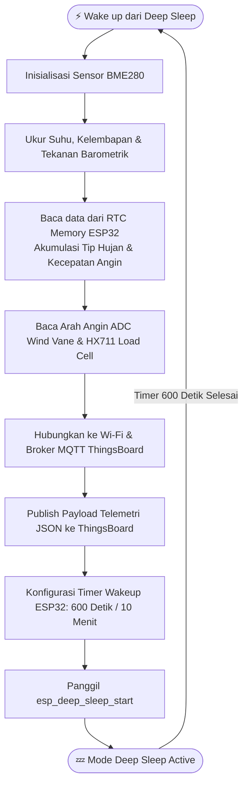

# 🌦️ Autonomous Solar-Powered Weather Station (AWS)

[](https://www.espressif.com/)
[](https://mqtt.org/)
[](https://thingsboard.io/)
[](#-power-management--deep-sleep)
[](LICENSE)

Sistem **Stasiun Cuaca Otomatis (Automatic Weather Station - AWS)** mandiri energi bertenaga surya (*Solar Powered*) berbasis **ESP32**. Sistem ini memantau parameter cuaca mikro secara *real-time*, memproses sensor analog, pulsa, $I^2C$, dan *load cell*, lalu mengirimkan data telemetri ke **ThingsBoard Cloud** via protokol **MQTT**.

---

## 📌 Fitur Utama

* ☀️ **Energy Autonomous:** Sumber daya mandiri menggunakan Panel Surya dan sistem manajemen baterai hemat energi.
* 💤 **Ultra-Low Power (Deep Sleep):** Menggunakan teknik penghematan daya ESP32 *Deep Sleep* interval 10 menit untuk memperpanjang usia baterai.
* 📊 **IoT Telemetry (ThingsBoard Cloud):** Visualisasi grafik parameter cuaca interaktif via Dashboard ThingsBoard.
* 🧠 **RTC Memory Persistence:** Data pencacah pulsa (curah hujan & kecepatan angin) disimpan pada *RTC Fast/Slow Memory* ESP32 agar tidak hilang saat mode *Deep Sleep*.
* 🔌 **Multi-Sensor Integration:**
  * 🌡️ **BME280:** Suhu, Kelembapan Udara, dan Tekanan Barometrik ($I^2C$).
  * 💨 **Anemometer:** Kecepatan Angin (Sinyal Pulsa Interupsi).
  * 🧭 **Wind Vane:** Arah Angin (Pembagi Tegangan Analog / ADC).
  * 🌧️ **Tipping Bucket / Load Cell (HX711):** Presipitasi Curah Hujan.

---

## 🏗️ Arsitektur & Blok Diagram Sistem

```
┌─────────────────────────────────────────────────────────────┐
│                       SENSORS LAYER                         │
│                                                             │
│  [Anemometer]     [Wind Vane]     [BME280]      [Load Cell] │
│   (Pulse Pin)    (Analog ADC)   (I2C Bus)      (HX711 ADC)  │
└───────┬───────────────┬─────────────┬───────────────┬───────┘
        │               │             │               │
        └───────────────┼─────────────┼───────────────┘
                        v             v
┌─────────────────────────────────────────────────────────────┐
│                    ESP32 MICROCONTROLLER                    │
│                                                             │
│  • Reads Sensors      • RTC Memory Counter Data             │
│  • WiFi & MQTT Client • Enters 10-Min Deep Sleep Mode       │
└───────────────────────┬─────────────────────────────────────┘
                        │ (WiFi / MQTT Payload JSON)
                        v
┌─────────────────────────────────────────────────────────────┐
│                      THINGSBOARD CLOUD                      │
│                                                             │
│      [Live Dashboards] ─── [Alerts] ─── [Historical Data]   │
└─────────────────────────────────────────────────────────────┘
```

---

## 🧰 Daftar Komponen & Bill of Materials (BOM)

| No | Nama Komponen | Jumlah | Fungsi / Deskripsi |
| :---: | :--- | :---: | :--- |
| 1 | **ESP32 DevKit V1 (Type-C)** | 1 | Mikrokontroler utama dengan fitur Wi-Fi & Deep Sleep |
| 2 | **ESP32 Terminal Block Expansion Board** | 1 | Board ekspansi terminal baut 38-pin untuk kabel sensor |
| 3 | **Sensor BME280** | 1 | Pengukur suhu, kelembapan, dan tekanan barometrik ($I^2C$) |
| 4 | **Anemometer (Pulse Output)** | 1 | Pengukur kecepatan angin berbasis interupsi pulsa |
| 5 | **Wind Vane Analog** | 1 | Pengukur arah angin berbasis pembagi tegangan analog |
| 6 | **Load Cell + Modul HX711** | 1 | Mengukur akumulasi berat air hujan ($mm$) |
| 7 | **Solar Power System Set** | 1 | Panel surya + Solar Charger Controller + Baterai Li-ion/LiFePO4 |
| 8 | **Enclosure Box Outdor (IP65)** | 1 | Wadah pelindung tahan cuaca eksternal |
| 9 | **Kabel Jumper & Terminal Wire** | 1 Set | Kabel interkoneksi antarsistem |

---

## 🔌 Pemetaan Pinout (Wiring Table)

| Komponen | Pin Sensor | Terminal ESP32 | Sinyal / Protokol |
| :--- | :--- | :--- | :--- |
| **BME280** | VDD / GND / SDA / SCL | 3V3 / GND / **GPIO 21** / **GPIO 22** | Digital ($I^2C$) |
| **Anemometer** | VIN / GND / Data Signal | 3V3 / GND / **GPIO 14** | Digital (Interrupt / Pulse) |
| **Wind Vane** | VCC / GND / Out Analog | 3V3 / GND / **GPIO 34** | Analog (ADC1_CH6) |
| **HX711 (Load Cell)** | VCC / GND / DT / SCK | 3V3 / GND / **GPIO 27** / **GPIO 13** | Digital Serial (DT/SCK) |
| **Power Input** | VCC (+5V) / GND | Port USB-C / VIN Pin | Power Input 5V DC (Solar/Battery) |

---

## 🔄 Alur Program & Logika Deep Sleep (Flowchart)



---

## 📄 Format Payload Telemetri JSON (MQTT)

Payload telemetri dikirimkan ke *topic* ThingsBoard `v1/devices/me/telemetry` dengan format JSON sebagai berikut:

```json
{
  "temperature": 28.45,
  "humidity": 74.20,
  "pressure": 1008.25,
  "wind_speed_ms": 3.85,
  "wind_direction_deg": 180.5,
  "rainfall_mm": 12.40,
  "battery_voltage": 4.12
}
```

---

## 💻 Contoh Kode Program (Arduino IDE / ESP-IDF)

```cpp
#include <WiFi.h>
#include <PubSubClient.h>
#include <Wire.h>
#include <Adafruit_Sensor.h>
#include <Adafruit_BME280.h>
#include "HX711.h"

// Konfigurasi Deep Sleep (10 Menit = 600 Detik)
#define TIME_TO_SLEEP  600        
#define S_TO_U_FACTOR  1000000ULL 

// Credential Wi-Fi & ThingsBoard MQTT
const char* ssid = "YOUR_WIFI_SSID";
const char* password = "YOUR_WIFI_PASSWORD";
const char* tb_broker = "thingsboard.cloud";
const char* tb_token = "YOUR_THINGSBOARD_TOKEN";

// RTC Memory untuk Menyimpan Akumulasi Pulsa saat Deep Sleep
RTC_DATA_ATTR int rtc_rain_pulse_count = 0;
RTC_DATA_ATTR int rtc_wind_pulse_count = 0;

Adafruit_BME280 bme;
WiFiClient espClient;
PubSubClient client(espClient);

void setup() {
  Serial.begin(115200);
  
  // 1. Inisialisasi Sensor I2C BME280
  Wire.begin(21, 22);
  if (!bme.begin(0x76)) {
    Serial.println("BME280 Sensor tidak ditemukan!");
  }

  // 2. Koneksi ke Wi-Fi & MQTT
  WiFi.begin(ssid, password);
  while (WiFi.status() != WL_CONNECTED) {
    delay(500);
  }
  
  client.setServer(tb_broker, 1883);
  if (client.connect("ESP32_AWS_Device", tb_token, NULL)) {
    // 3. Baca Parameter Sensor
    float temp = bme.readTemperature();
    float hum = bme.readHumidity();
    float press = bme.readPressure() / 100.0F;
    int wind_adc = analogRead(34);

    // 4. Buat Payload JSON & Kirim
    String payload = "{";
    payload += "\"temperature\":" + String(temp) + ",";
    payload += "\"humidity\":" + String(hum) + ",";
    payload += "\"pressure\":" + String(press) + ",";
    payload += "\"wind_direction_adc\":" + String(wind_adc);
    payload += "}";

    client.publish("v1/devices/me/telemetry", payload.c_str());
    delay(1000);
  }

  // 5. Masuk Mode Deep Sleep selama 10 Menit
  esp_sleep_enable_timer_wakeup(TIME_TO_SLEEP * S_TO_U_FACTOR);
  Serial.println("Masuk Mode Deep Sleep...");
  esp_deep_sleep_start();
}

void loop() {
  // Loop kosong karena sistem menggunakan Deep Sleep
}
```

---

## 👥 Tim Pengembang

* **Shasy Calistha Rahmadani**
* **Tim Proyek Stasiun Cuaca IoT (AWS)**

**Departemen Fisika — Fakultas Matematika dan Ilmu Pengetahuan Alam, IPB University**